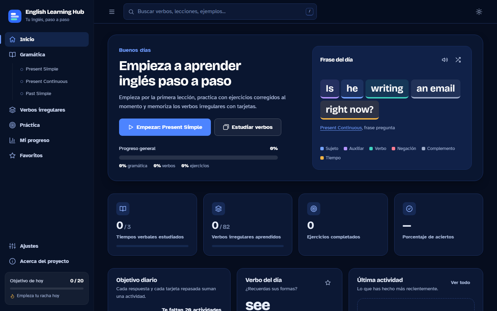
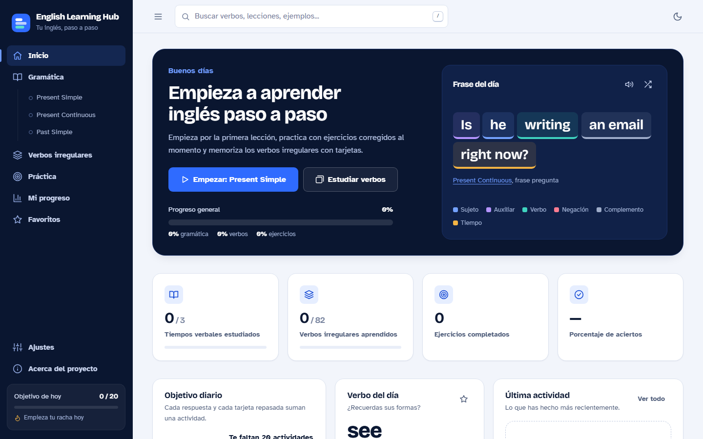
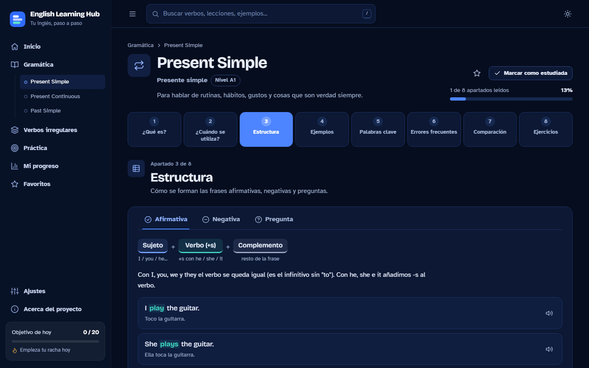
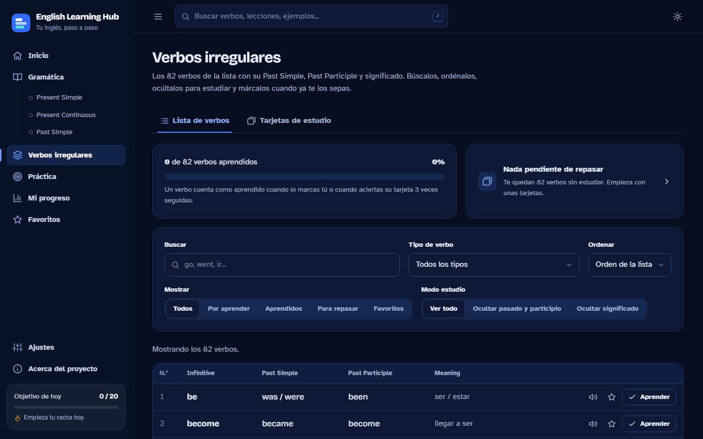
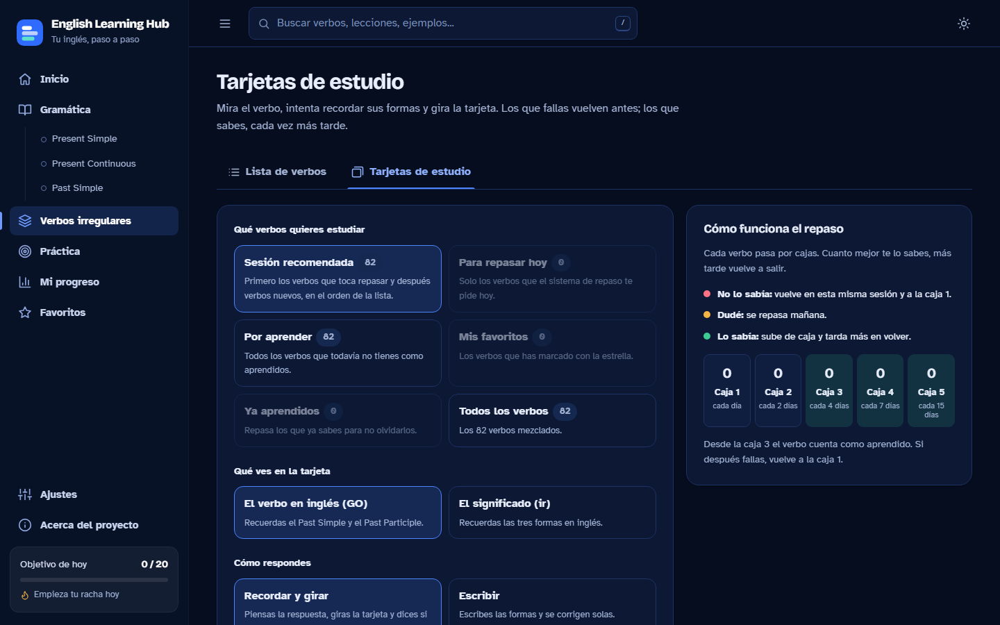
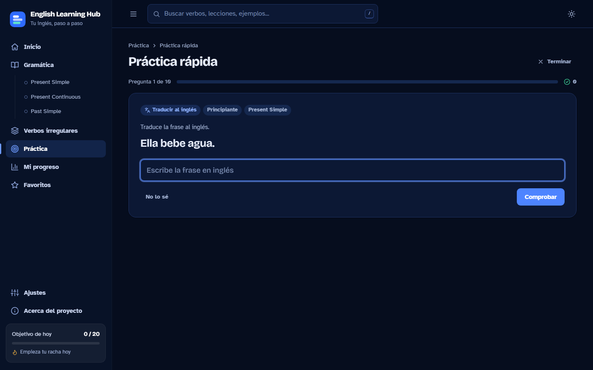
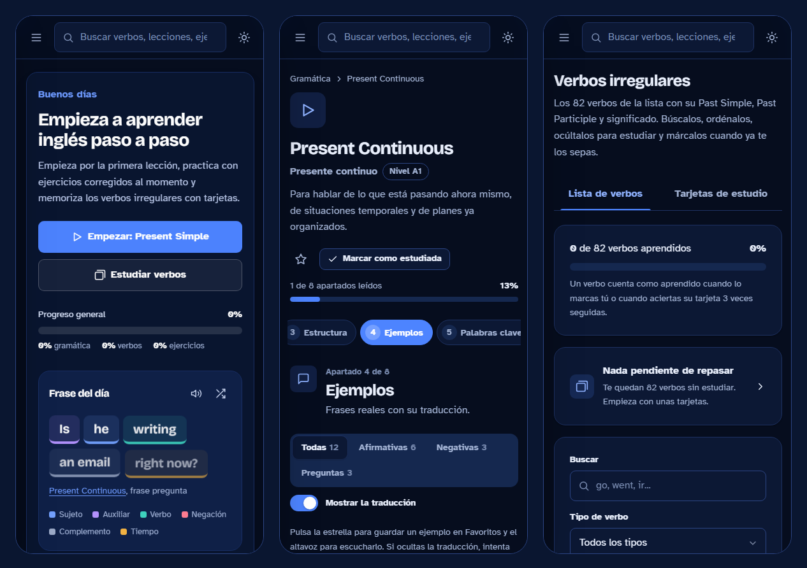

# English Learning Hub

> English Learning Hub — Proyecto personal desarrollado para aprender inglés y mejorar mis conocimientos de desarrollo web.

Plataforma web personal para aprender inglés paso a paso: lecciones interactivas de gramática, los 82 verbos irregulares con tarjetas de estudio y repaso espaciado, ejercicios corregidos al momento y seguimiento del progreso. Funciona sin servidores, sin cuentas y sin bases de datos: todo se guarda en el navegador.

**Web publicada:** <https://marcoscabrera72006.github.io/English-Learning-Hub/>

## Funcionalidades

- **Inicio:** progreso general, tiempos verbales estudiados, verbos aprendidos, ejercicios y porcentaje de aciertos, objetivo diario con racha, frase del día, verbo del día, última actividad y acceso para continuar.
- **Gramática:** Present Simple, Present Continuous y Past Simple. Cada lección tiene 8 apartados: ¿Qué es?, ¿Cuándo se utiliza?, Estructura (con fórmulas de colores, tabla de conjugación y constructor de frases), Ejemplos con traducción, Palabras clave, Errores frecuentes, Comparación y Ejercicios.
- **Verbos irregulares:** los 82 verbos de la lista con búsqueda, filtros, orden alfabético, modo estudio (ocultar respuestas), marcar como aprendido, favoritos, pronunciación y tarjetas de estudio con repetición espaciada (sistema de cajas de Leitner).
- **Práctica:** 8 tipos de ejercicio (completar, elegir, pasar a negativa, pasar a pregunta, traducir, identificar el tiempo verbal, verbos irregulares y corregir errores) en 3 niveles. Cada respuesta se corrige con la solución, la explicación y pistas sobre el error. Se priorizan las preguntas nuevas y las falladas.
- **Mi progreso:** actividad diaria, avance por lección, cajas de repaso de los verbos, aciertos por tipo y nivel, errores más frecuentes y últimos fallos.
- **Extras:** buscador general (atajo `/` o `Ctrl + K`), favoritos, modo claro y oscuro, diseño adaptable a móvil, copia de seguridad (descargar y cargar) y reinicio del progreso con confirmación.

## Tecnologías

- HTML5, CSS3 y JavaScript sin frameworks ni dependencias.
- `localStorage` para guardar el progreso.
- Web Speech API para escuchar las frases (si el navegador la permite).
- Compatible con GitHub Pages (web estática).

## Cómo abrirlo en local

**Opción 1:** haz doble clic en `index.html`. Funciona directamente en el navegador.

**Opción 2 (recomendada):** sirve la carpeta con un servidor local, por ejemplo con Python:

```bash
cd English-Learning-Hub
python -m http.server 8000
```

y abre `http://localhost:8000`.

> El progreso se guarda por navegador y por dirección: lo que hagas con doble clic y lo que hagas en `localhost` se guarda por separado. Para pasarlo de un sitio a otro usa **Ajustes → Copia de seguridad**.

## Publicar en GitHub Pages

1. Crea un repositorio en GitHub (por ejemplo, `english-learning-hub`).
2. Sube el contenido de la carpeta `English-Learning-Hub` a la raíz del repositorio:
   ```bash
   git init
   git add .
   git commit -m "English Learning Hub"
   git branch -M main
   git remote add origin https://github.com/TU-USUARIO/english-learning-hub.git
   git push -u origin main
   ```
3. En GitHub, ve a **Settings → Pages**, elige **Deploy from a branch**, rama `main` y carpeta `/ (root)`, y guarda.
4. En uno o dos minutos la web estará en `https://TU-USUARIO.github.io/english-learning-hub/`.

El archivo `.nojekyll` ya está incluido para que GitHub Pages sirva todos los archivos tal cual.

## Estructura

```
English-Learning-Hub/
├── index.html            Página principal (carga todos los scripts)
├── data/                 CONTENIDOS
│   ├── tenses/           Una lección por archivo
│   ├── irregular-verbs.js
│   ├── skills.js         Categorías de error
│   └── site-config.js    Nombre del autor y GitHub
├── components/           Piezas reutilizables (ejercicios, tarjetas, buscador...)
├── pages/                Una página por sección
├── scripts/              Núcleo (almacenamiento, rutas, motor gramatical) y arranque
├── styles/               Diseño
├── assets/               Icono y capturas
└── docs/                 Guía para añadir lecciones
```

Para añadir un tiempo verbal o cambiar los verbos, sigue [docs/COMO-ANADIR-LECCIONES.md](docs/COMO-ANADIR-LECCIONES.md).

## Capturas

Capturas de la primera visita (sin progreso guardado). Están en `assets/screenshots/`; si cambias el diseño, sustitúyelas por otras con el mismo nombre.

**Inicio en modo oscuro**



**Inicio en modo claro**



**Lección: apartado Estructura del Present Simple**



**Lista de los 82 verbos irregulares**



**Tarjetas de estudio con repaso espaciado**



**Práctica rápida**



**En el móvil**



## Autor y créditos

- **Autor:** MarcosCabrera06 — [github.com/marcoscabrera72006](https://github.com/marcoscabrera72006). En la web, estos datos se cambian en `data/site-config.js`.
- **Lista de verbos irregulares:** material de clase (Irregular verbs). Los 82 verbos, sus formas y sus traducciones se han copiado sin cambios.
- **Iconos:** basados en el estilo de Lucide (licencia ISC).
- **Tipografías:** Bricolage Grotesque y Atkinson Hyperlegible, de Google Fonts (licencia SIL Open Font).
